<a href="https://pandeyrupak.com.np">
  
</a>

<p align="center">
  <a href="https://pandeyrupak.com.np"></a>
  <a href="mailto:rupakpandey431@gmail.com"></a>
  <a href="https://www.linkedin.com/in/rupak-pandey-347391348"></a>
</p>

## `$ whoami`

**Curiosity got me into computers. Building things is what kept me here.**

I'm a software developer at **Matrika Technology** in Kathmandu, building full-stack web
apps and Flutter mobile apps for client projects, while studying for a **Bachelor of
Information Technology** at Padmashree International College (Nilai University).

Most of what I build on my own is aimed at problems specific to Nepal: vehicle rental,
personal finance and health tracking, where the existing tools either don't exist or don't
fit how things work here.

## `$ git log --graph --reverse`

```text
* a1c9e40  init: Computer Engineering track under TEVT            class 9 – 12
|\
| * 5d1f7b2  intern: Mobile App Development · Teko Techs          2025 · 2 months
|/           flutter · dart · android
* 9e04c31  feat: Bachelor of Information Technology               2026
|\
| * 3b8f61d  intern: Software Development · Matrika Technology    2026 · 3 months
|/           web · flutter · team
* 0c7a2e8  merge: offered the job at the end of the internship
* e72ec16  (HEAD -> main) Software Developer · Matrika Technology   2026 — now
```

## `$ ls ~/work`

**[Sajilo Sawari](https://github.com/Rupak321/sajilo-sawari)** · `TypeScript` `PostgreSQL` · in development<br />
A multi-vehicle rental marketplace for Nepal: two-wheelers, cars, vans, goods transport and
special equipment, listed by individuals and organisations. Every listing is verified against
real documents (Bluebook, insurance, tax receipt, licence), and every vehicle can be booked
with or without a driver.

**[Watch Together](https://github.com/Rupak321/watch-together)** · `JavaScript` `Cloudflare` `WebRTC`<br />
Watch the same film at the same moment with friends somewhere else. Every playhead in a room
is held to one clock within about a tenth of a second, with voice, camera, chat and reactions
on the same screen. No account, and it runs free on Cloudflare's edge.

**[Smart Expense](https://github.com/Rupak321/Smart-Expense-Tracker)** · `Flutter` `Firebase` · 156 passing tests<br />
A personal finance app for Android that records income and spending, shows where the money
goes, and exports reports you can share.

**[Fitevo](https://github.com/Rupak321/fitevo)** · `Flutter` `Firebase` `Groq` `Gemini`<br />
A local-first fitness, nutrition and workout tracker for beginners. Log a meal in one plain
sentence and the model works out the nutrition and updates the day's targets. No paywalls,
no shaming.

**[Blazify](https://github.com/Rupak321/blazify)** · `Kotlin` `Jetpack Compose` · built together<br />
A music streaming player for Android, with a desktop build for Linux and Windows.

<details>
<summary><b>Everything else, oldest lessons included</b></summary>

<br />

| Project | What it is | Stack |
| --- | --- | --- |
| [60 Days of Flutter](https://github.com/Rupak321/Flutter-Learning-Projects-60-Days) | Sixty days of small builds, from basics to state management | Flutter |
| [PRESCRIPTO](https://github.com/Rupak321/PRESCRIPTO) | Doctor appointment and prescription platform | JavaScript |
| [Car-Rental](https://github.com/Rupak321/Car-Rental) | Vehicle rental web application | JavaScript |
| [Majestic-Motors](https://github.com/Rupak321/Majestic-Motors) | Automotive showcase site | JavaScript |
| [AstroNepal](https://github.com/Rupak321/AstroNepal) | Nepali astrology platform: rashifal, calendar, news | Java |
| [Shop-Easy](https://github.com/Rupak321/Shop-Easy) | E-commerce storefront | PHP |
| [To-Do-Application](https://github.com/Rupak321/To-Do-Application) | Task manager | Flutter |
| [Quiz-Application](https://github.com/Rupak321/Quiz-Application) | Quiz app that keeps a score history | Java |
| [Visual-Programming](https://github.com/Rupak321/Visual-Programming) | Desktop UI coursework | C# |
| [Java](https://github.com/Rupak321/Java) | Employee management system | Java |

</details>

## `$ ls ~/stack`



## `$ git log --since=1.year`



<br />

<a href="mailto:rupakpandey431@gmail.com">
  
</a>
